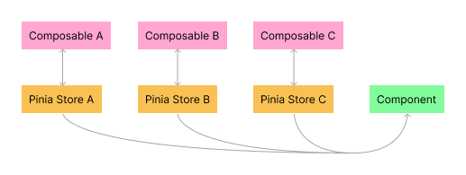

#### JavaScript > Vue > Pinia
# Pinia: how to create data

---
## Before:
- Overview of the Pinia workflow:


---
## 1) Applying Pinia in the app:
If you are using JavaScript, `/src/main.js`. If TypeScript, `/src/main.ts`:
```js
// Importing:
...
import { createPinia } from "pinia";

// Declarations:
...
const pinia = createPinia();

// Installing Vue plugins:
...
app.use(pinia);

...
```

---
## 2) Creating the `/stores/` folder:
Create the `/frontend/src/stores/` folder.

---
## 3) Creating the data work-flow:
### Step 1/4 - State
Declare the state property and its initial value in `/store/index.js` (frontend db):
E.g.
```js
import { createStore } from 'vuex'
export default createStore({
	// State means data for VueX:
	state: {
		products = [],  // this is the declaration of 'products' state/data!
		cart = [],      // this is another declaration.
	},
	actions: {}
	mutations: {}
	modules: {}
})
```

......................................

### Step 2/4 - View & Dispatch
In a component `.vue` file or in the app `.vue` main file, the component (view) need to be linked with its state and dispatch:

**View:**
At first, let's allow the view to display the state/data:

When the view is a component `.vue` file:
```js
// Importing a Vuex Helper to handle states:
import { mapState } from 'vuex'

export default {
	name: 'Home',  // component name
	data() {
		...
	}
	// Computed Properties:
	computed: mapState([
		'products',  // It's a state property (data)!
		'cart'  // It's a state property (data)!
	]),

	// Lifecycle hook:
	// ...
}
```
When the view is an App `.vue` file:     XXXXXXXXXXXXXX NO SURE IF IT CAN HAPPENING xXXXXXXXXXXXXXXXXXXXX

**Dispatch:**
In the view where the data is shown, address/dispatch the action to update a specific state property (data):

When the data must be loaded automatically:

Set the data dispatch in the App `.vue` file:
```js
export default {
	// Computed Properties:
	// ...

	// Lifecycle hooks:
	created() {
		this.$store.dispatch('actLoadProducts');  // 'actLoadProducts' is the action to call.
	}
}
```
More about Lifecycle-hooks: [/javascript/web-development/frontend/vue/vue-knowledge/lifecycle-hooks](/javascript/web-development/frontend/vue/vue-knowledge/lifecycle-hooks.md)

When the data must be loaded just after some user directly interaction, set the dispatch in a component `.vue` file:

On `<template>` layer:
```html
<button
	type="button"
	@click="btCartAddProd(prod)"  <!-- considering 'prod' comes from a for-loop -->
>
	Add to Cart
</button>
```

On `<script>` layer:
```js
export default {
	// Lifecycle hook:
	// ...

	// Methods/functions:
	methods: {
		// Addressing/Dispatching the action responsable for update something:
		btCartAddProd(prod) {
			// This function is called if a user click over the 'Add to Cart' button.
			this.$store.dispatch('actCartAddProd', prod);  // 'actCartAddProd' is the action to call.
		}
	}
}
```

......................................

### Step 3/4 - Action
Back to the `/store/index.js`, create an action that will execute a mutation (next step) to update a specific state/data when called.
When the data must be loaded directly from an API/JSON:
- Using FetchAPI (native of JavaScript): [/javascript/web-development/frontend/z-examples/fetch-api-on-vuejs/vuex_action_using_fetchApi](/javascript/web-development/frontend/z-examples/fetch-api-on-vuejs/vuex_action_using_fetchApi.md)
- Using Node.js Axios: [/javascript/nodejs/component-libraries/axios-api/axios](/javascript/nodejs/component-libraries/axios-api/axios.md)

When the data is already in a state, but can be updated by another action:
```js
export default createStore({
	//...
	actions: {
		//...
		actCartAddProd({ commit }, prod) {
			// This function calls the mutation responsable to add the product to the shopping cart.
			commit('mutAddProd', prod);
		},
	},
	//...
})
```

......................................

### Step 4/4 - Mutation
Finally and still in `/store/index.js`, create the mutation that will execute the action over a state. In other words, it adds/updates a specific state/data when activated:
All mutation examples used on this overview about Vuex:
```js
mutations: {
	// Finally, it 'sends' all products to Vue components that request its action!
	mutLoadProducts(state, products) {
		state.products = products;
	},
	// 'mutAddProd' is the mutation, and 'prod' argument is the data itself
	// defined from the action step:
	mutAddProd(state, prod) {
		state.cart.push(prod);
	},
	mutDelProd(state, prodID) {
		var updatedCart = state.cart.filter(item => prodID !== item.id);
		state.cart = updatedCart;
	}
},
```

---
## Testing it:
Checking whether the data is been sent to the browser, using the *Vue DevTool*:
- Open the Browser Develop Tool;
- Go to the Vue tab;
- Select the component where the data is;
- If everything's fine, you're seeing the *computed* with its data (array, probably) somewhere on the dev panel;


